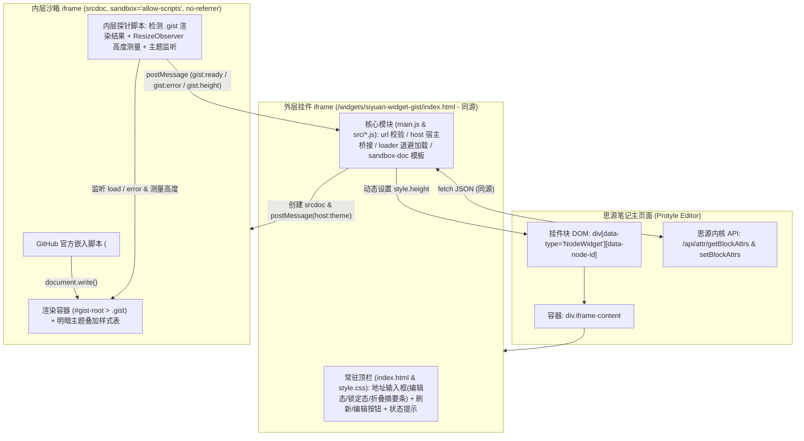
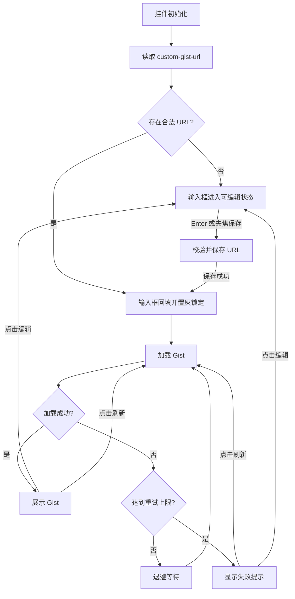

# siyuan-widget-gist · 系统架构与技术设计文档 (ARCHITECTURE)

> **版本**：v1.0（正式发布稿）  
> **状态**：已定稿（Approved）  
> **定位**：定义 `siyuan-widget-gist` 的技术栈选型、双层 iframe 沙箱隔离拓扑、整体运行流程、思源宿主集成契约、常驻输入框状态机、Gist 明暗主题叠加样式、SVG 图标编译流水线与双层高度自适应机制  
> **关联文档**：[AGENTS.md](../AGENTS.md) · [PRD.md](PRD.md)

---

## 1. 架构概览与技术选型

### 1.1 技术栈选型

| 维度 | 技术方案 | 设计约束 |
|---|---|---|
| **思源扩展形态** | 原生挂件（`NodeWidget`） | 部署于思源工作区 `/data/widgets/siyuan-widget-gist/`，由 `/挂件` 菜单挂载 |
| **运行期语言** | HTML5 + CSS3 + 原生 JavaScript (ES Modules) | 零 npm 运行时依赖、零前端框架、零客户端打包器 |
| **配置持久化** | 思源内核 REST API (`/api/attr/*`) | 仅读写当前挂件块的 `custom-gist-url` 属性，不落盘高度或本地缓存文件 |
| **远程脚本隔离** | 双层 iframe（外层同源挂件 + 内层 `srcdoc` 沙箱） | 内层固定 `sandbox="allow-scripts"` 与 `referrerPolicy="no-referrer"` |
| **跨层通信** | `window.postMessage` + `ResizeObserver` | 内层汇报 `gist:ready`、`gist:error`、`gist:height`；外层校验 `event.source` 并同步 `host:theme` |
| **资产与打包工具** | `@resvg/resvg-js`（开发期依赖）+ Node 内置 `node:zlib` | 仓库仅追踪 `assets/*.svg`，构建时生成 `.generated/icon.png` 与 `.generated/preview.png` 并归档 `package.zip` |

### 1.2 双层 iframe 隔离拓扑

GitHub 官方 Gist 嵌入脚本（`https://gist.github.com/<user>/<id>.js`）依赖同步 `document.write()` 向文档流注入样式表与代码 DOM。为防止第三方脚本访问思源同源上下文、`window.parent` 或内核接口，系统采用**外层同源宿主挂件 + 内层 opaque origin 沙箱 iframe** 的双层隔离架构：



### 1.3 目录与文件划分

```text
siyuan-widget-gist/
├── AGENTS.md             # AI 代理开发约束与门禁规范
├── package.json          # pnpm 工程指令与开发期图标渲染依赖 (@resvg/resvg-js)
├── widget.json           # 思源挂件集市清单（声明名称、版本、图标、中英描述）
├── index.html            # 外层挂件页面结构（常驻地址栏、工具按钮、状态区与渲染容器）
├── style.css             # 外层挂件样式表（明暗主题变量、锁定/编辑态区分与折叠摘要条样式）
├── main.js               # 挂件入口与顶栏 UI 交互编排
├── src/
│   ├── url.js            # 纯函数：Gist URL 解析规范化与指数退避间隔计算
│   ├── sandbox-doc.js    # 内层沙箱 iframe HTML 模板、浅/深色 Gist 叠加样式与探针脚本
│   ├── host.js           # 思源宿主桥接：块 ID 解析、块属性读写 API、明暗主题/折叠监听与高度同步
│   └── loader.js         # 内层沙箱生命周期管理器：代际控制、20s 超时、10 次退避重试与 postMessage 通信
├── assets/
│   ├── icon.svg          # 挂件矢量图标源图（用于 README 展示并编译生成 160x160 icon.png）
│   └── preview.svg       # 挂件矢量预览源图（编译生成 1024x768 preview.png）
├── README.md             # 英文用户说明文档
├── README.zh-CN.md       # 中文用户说明文档
├── LICENSE               # MIT 开源许可证
├── scripts/
│   ├── build/
│   │   ├── render-icons.mjs      # 基于 @resvg/resvg-js 将 SVG 渲染为 .generated/icon.png 与 preview.png
│   │   └── package-zip.mjs       # 组装 dist/ 并生成标准 package.zip (node:zlib)
│   ├── dev/
│   │   └── install-workspace.mjs # 本地思源工作区 data/widgets/siyuan-widget-gist 安全原子安装
│   ├── release/
│   │   ├── read-version.sh       # CI 从 widget.json 提取 SemVer 版本
│   │   ├── reconcile-tag.sh      # Tag 与 GitHub Release 状态协调
│   │   ├── update-version.mjs    # package.json 与 widget.json 双清单版本同步升级
│   │   ├── verify-package.mjs    # dist/、PNG 标头、README 图标引用与 package.zip 静态校验
│   │   └── release.mjs           # 本地一键发版校验流水线
│   └── clean.mjs                 # 清理 dist/、.generated/ 与 package.zip
└── docs/
    ├── PRD.md            # 产品需求规范（已固化基线）
    └── ARCHITECTURE.md   # 系统架构与技术设计文档
```

---

## 2. 整体运行流程与生命周期

挂件从初始化读取属性、常驻输入框编辑/失焦自动保存、置灰锁定、沙箱加载判定、指数退避重试到手动刷新的完整运行流程如下：



---

## 3. 思源宿主集成契约

### 3.1 宿主 DOM 结构与块 ID 定位

根据思源前端源码（`app/src/protyle/hint/extend.ts:941-951`、`app/src/protyle/render/mediaResize.ts:3-15`），思源插入挂件时生成的 DOM 结构为：

```html
<div data-node-id="20261126190000-abcdefg" data-type="NodeWidget" class="iframe">
    <div class="iframe-content">
        <iframe src="/widgets/siyuan-widget-gist/?siyuan-version=..." data-subtype="widget" border="0" frameborder="no" framespacing="0" allowfullscreen="true"></iframe>
        <span class="protyle-action__drag protyle-block-resize" contenteditable="false" data-resize-axis="both"></span>
    </div>
    <div class="protyle-attr" contenteditable="false">​</div>
</div>
```

外层挂件与思源主页面同源，在 `src/host.js`（`resolveHostContext`）中通过 `window.frameElement` 向上查找最近的 `[data-type="NodeWidget"]` 块元素并提取块 ID：

```js
const hostFrame = window.frameElement;
const hostBlock = hostFrame?.closest('[data-type="NodeWidget"]') ?? null;
const blockId = hostBlock?.dataset?.nodeId || hostBlock?.getAttribute('data-node-id') || '';
```

- 当直接在浏览器独立标签页打开 `/widgets/siyuan-widget-gist/` 导致 `blockId` 为空时，状态区展示 `请在思源笔记挂件中打开`，禁用属性写入接口调用。

### 3.2 内核块属性读写契约

对照思源后端源码（`kernel/api/attr.go:30-73`），块属性读写接口契约如下：

| 操作 | 路径与方法 | 请求体 JSON | 成功响应判定 |
|---|---|---|---|
| **读取属性** | `POST /api/attr/getBlockAttrs` | `{ "id": "<blockId>" }` | HTTP 200 且 `res.code === 0`，读取 `res.data["custom-gist-url"]` |
| **保存属性** | `POST /api/attr/setBlockAttrs` | `{ "id": "<blockId>", "attrs": { "custom-gist-url": "<normalizedUrl>" } }` | HTTP 200 且 `res.code === 0` |

- **读取异常隔离**：若 `getBlockAttrs` 网络失败或返回 `code !== 0`，展示读取失败提示并允许点击刷新重试，不误判为空配置；
- **写后状态推进**：仅在 `setBlockAttrs` 返回 `code === 0` 后，才更新内存中的 `savedUrl`、同步宿主块 DOM 上的 `custom-gist-url` 属性、将常驻输入框切换为置灰锁定态并启动新加载序列。

### 3.3 思源明暗主题感知与双层联动

对照思源前端源码（`app/src/util/assets.ts:163-239, 498-504` 与 `app/src/assets/scss/util/_reset.scss:18-28`），思源切换主题时会先修改 `data-theme-mode`，再异步加载 `<head>` 中的主题样式表，且根元素声明了 `color-scheme: dark/light`。

`src/host.js` 中的 `observeHostTheme` 实现多源主题同步：
1. **权威模式判定**：优先读取 `window.parent.siyuan.config.appearance`（兼容 `modeOS` 跟随系统与 `mode` 0/1），依次回退 `data-theme-mode` 属性、`#themeDefaultStyle` 的 `href` 与系统 `prefers-color-scheme`；
2. **双观察器与异步样式表同步**：同时监听宿主 `document.documentElement` 属性变更、`document.head` 中主题 `<link>` 节点的增删/修改（挂接一次性 `load` 监听与 `250ms` 兜底重读）及系统配色媒体查询；
3. **亮度防抖与 `color-scheme` 对齐**：通过 `isBgCompatibleWithMode` 过滤尚未卸载的旧主题背景色，避免切换瞬间写入陈旧 `--b3-theme-background`；外层 `style.css` 与内层 `src/sandbox-doc.js` 均显式声明匹配的 `color-scheme: light/dark`，防止浏览器为暗黑模式下的透明 iframe 填充白色画布；外层通过 `loader.broadcastTheme(mode)` 向内层沙箱发送 `{ type: 'host:theme', mode }` 实现免重载即时切色。

### 3.4 思源块折叠状态同步 (`fold="1"`)

对照思源前端源码（`app/src/protyle/util/blockFold.ts:66, 118-124, 150-159` 与 `app/src/assets/scss/protyle/_wysiwyg.scss:905-991`），思源对非标题块执行折叠时在块根元素上设置 `fold="1"` 属性，展开时移除该属性。

`src/host.js` 的 `observeHostFold` 在初始化时读取 `hostBlock.getAttribute('fold') === '1'`，并通过 `MutationObserver`（`attributeFilter: ['fold']`）持续监听 `hostBlock` 的折叠属性变更，交由 `main.js` 的 `applyFoldState` 处理：
1. **进入折叠态（`fold="1"`）**：设置 `#app[data-folded="true"]`，调用 `loader.cancel({ removeRendered: true })` 终止加载/退避定时器并销毁内层沙箱 iframe；顶栏切换为高对比度折叠摘要条（展示 `▶ GitHub Gist` 徽标与 `3px` 主题色左边框、取消锁定态透明度衰减并改用主文字色以抵消思源 `[fold="1"]` 的 `opacity: 0.38`、隐藏刷新按钮并展示「已折叠」标签），调用 `resizeHost()` 将挂件块高度收缩为单行紧凑高度；
2. **退出折叠态（移除 `fold`）**：将 `#app[data-folded="false"]` 还原为常规顶栏样式；若存在已保存的 `savedUrl` 且当前未渲染，立即调用 `loader.start(savedUrl)` 拉取并渲染 Gist。

---

## 4. 核心模块与状态机设计

### 4.1 URL 解析与规范化纯函数 (`parseGistUrl`)

`parseGistUrl(rawInput)` 为零副作用纯函数，按以下流水线校验并输出规范化 URL：

1. **空白清理与脚本标签剥离**：
   - 对输入执行 `.trim()`；
   - 若输入以 `<` 开头或包含 `<script`：使用严格正则 `/^<script\b[^>]*?\bsrc\s*=\s*(?:"([^"]+)"|'([^']+)')[^>]*>\s*<\/script>$/i` 匹配单个标准闭合 `<script>` 标签并提取 `src` 属性（同时还原 `&amp;` 为 `&`）；任何带有额外属性注入、内联脚本体或多标签的 HTML 字符串直接拒绝；
2. **URL 实例解析与主机校验**：
   - 使用 `new URL(extracted)` 解析；
   - 强制校验 `url.protocol === 'https:'`、`url.hostname === 'gist.github.com'`、`url.username === ''`、`url.password === ''`、`url.port === ''`；
3. **路径与 Gist ID 校验**：
   - 拆分 `url.pathname`，兼容两段式 `/<username>/<gistId>[.js]` 与单段式 `/<gistId>[.js]`；
   - `<username>` 须匹配 GitHub 用户名规范 `/^[a-zA-Z0-9](?:[a-zA-Z0-9-]{0,37}[a-zA-Z0-9])?$/`（排除 `discover`、`search`、`starred`、`forked` 等非 Gist 保留路由词）；
   - `<gistId>`（去除可选 `.js` 后缀后）须匹配 `/^[a-fA-F0-9]{1,64}$/`；
   - 统一为路径末尾补齐 `.js` 后缀；
4. **查询参数白名单过滤**：
   - 仅当 `url.searchParams.get('file')` 存在且 `.trim()` 非空时，在新 URL 上保留单一 `file` 参数；丢弃其余所有查询参数与 `url.hash`；
5. **输出结构**：
   - 成功：`{ ok: true, url: normalizedUrl }`
   - 失败：`{ ok: false, error: '请输入有效的 GitHub Gist URL 或官方 <script> 嵌入代码' }`

### 4.2 常驻输入框状态机与加载生命周期划分

状态按职责拆分为两层，避免单文件耦合：
- **顶栏 UI 与宿主状态（`main.js`）**：维护 `blockId`、`hostFrame`、`hostBlock`、`themeMode`、`folded`、`savedUrl`、`editing`、`saving` 与 `editBtnPointerDownWhileEditing`；
- **沙箱加载与退避重试状态（`src/loader.js` `createGistLoader`）**：独立封装 `retryCount`、`retryTimer`、`countdownTimer`、`loadTimer`（20s）、`currentFrame`、`renderedFrame`、`hasRenderedContent`、`loadSettled` 与单调递增代际号 `loadSeq`，对外暴露 `start`、`cancel`、`broadcastTheme`、`isLoading`、`isActive`、`hasRendered` 与 `dispose`。

- **锁定态与编辑态切换 (`setEditing(active)`)**：
  - `active === false`（锁定态）：`dom.input.readOnly = true`、`dom.bar.dataset.editing = 'false'`，隐藏状态标签，输入框展示置灰底色与次要文字色，`text-overflow: ellipsis` 省略超长尾部；单击不触发编辑，**双击输入框**或点击右侧「编辑」按钮进入编辑态；
  - `active === true`（编辑态）：`dom.input.readOnly = false`、`dom.bar.dataset.editing = 'true'`，显示「编辑中」状态标签，输入框切换为高亮编辑底色与聚焦光晕，「编辑」按钮同步呈现激活态；
- **`Enter` 与 `blur` 协同无竞态提交 (`commitInput({ trigger })`)**：
  - `Enter` 按下时调用 `commitInput({ trigger: 'enter' })`：保存成功后先执行 `setEditing(false)` 再调用 `dom.input.blur()`；`blur` 监听器检测到 `!state.editing || state.saving` 时立即短路返回，避免重复触发保存；
  - 鼠标点击挂件外部或焦点移出输入框触发 `blur` 时调用 `commitInput({ trigger: 'blur' })`：
    1. 若 `savedUrl === ''` 且输入为空白：保持未配置可编辑空状态，不报错；
    2. 若 `savedUrl !== ''` 且输入规范化结果等于 `savedUrl`（用户点击编辑后未改动内容便移开焦点）：回填规范化 `savedUrl`、清除临时校验状态并调用 `setEditing(false)` 恢复置灰锁定态；
    3. 若输入为新的合法 Gist 地址：调用 `saveGistUrl` 落盘，成功后 `setEditing(false)` 切换置灰锁定态并调用 `loader.start(parsed.url)` 自动刷新 Gist；
    4. 若输入内容不合法：保持 `editing = true` 高亮错误边框并展示校验提示，保留原已渲染 Gist 不被卸载；
  - 在「编辑」按钮 `pointerdown` 阶段记录编辑态快照，若点击前已处于编辑态，则交由输入框 `blur` 完成自动保存与锁定收起，避免 `click` 事件再次重开编辑态。

### 4.3 内层沙箱 `srcdoc` 渲染与 Gist 定制样式叠加 (`src/sandbox-doc.js`)

GitHub 官方 `gist-embed-*.css` 默认仅内置浅色样式，且带有 `.gist .gist-file { margin-bottom: 1em }` 与 `.gist .file.my-2 { margin: 8px 0 }` 等外边距。参照主流 Hexo 主题（NexT / Fluid）对 `.gist` DOM 层级（`.gist` → `.gist-file` → `.gist-data` → `.blob-wrapper` → `table.highlight` → `td.blob-num` / `td.blob-code` + `.gist-meta`）的定制方案，`src/sandbox-doc.js` 中的 `buildGistSrcdoc(validatedUrl, seq, themeMode)` 在官方 `<script>` 标签**之后**注入定制 `<style>` 层叠规则：

1. **布局与卡片精修**：清除 `.file.my-2` 与 `.gist-file` 多余外边距（多文件 Gist 通过 `.gist-file + .gist-file` 保留间距），统一圆角边框、紧凑底栏 `.gist-meta`、等宽代码字体栈、行号右分隔线、代码行悬停高亮（`tr:hover`）与细滚动条；
2. **深色模式语法高亮适配 (`:root[data-theme="dark"]`)**：声明 `color-scheme: dark` 并采用中性深灰底色（`#1e1e1e` / `#252526` / `#3c3c3c`）覆盖 `.gist-file`、`.gist-data`、`.gist-meta`、`.blob-num`、`.blob-code`、`.markdown-body`，同时完整映射 GitHub Primer Dark 的 `.pl-*` 语法高亮着色（注释 `.pl-c`、关键字 `.pl-k`、字符串 `.pl-s`、函数/类名 `.pl-en`/`.pl-e`、常量 `.pl-c1`、变量/参数 `.pl-v`/`.pl-smi`、增删差异 `.pl-mi1`/`.pl-md` 等）；
3. **加载结果精准探测**：脚本同步执行完毕后，探针脚本检查 `#gist-root` 内是否存在 `.gist` 且包含 `.gist-file` 或 `.gist-data` 节点，区分 `gist:ready` 与 `gist:error`，配合外层 20 秒超时定时器与 `loadSettled` 单次结算锁驱动指数退避重试。

---

## 5. 双层 iframe 高度自适应与工程打包

### 5.1 双层 `ResizeObserver` 高度同步

1. **内层测量**：测量 `#gist-root` 与 `.gist` 的真实边界高度（不读取 `document.documentElement.scrollHeight` 或视口高度），确保长短 Gist 切换与窗口宽度变化时高度可增可减，通过 `{ type: 'gist:height', seq, height }` 通知外层；
2. **外层与宿主块同步 (`resizeHost`)**：对照思源源码 `app/src/protyle/gutter/height.ts:16-39` 与 `app/src/assets/scss/component/_typography.scss:648-668`，外层同步更新 `hostFrame.style.height` 与 `hostBlock.style.height`，并在尺寸未变化时跳过写入以避免重排循环。

### 5.2 矢量图标编译与集市打包流水线

1. **单一 SVG 事实源**：仓库仅追踪 `assets/icon.svg`（`160×160`）与 `assets/preview.svg`（`1024×768`），根目录不追踪静态 `icon.png` / `preview.png`；
2. **构建期渲染 (`scripts/build/render-icons.mjs`)**：使用 `@resvg/resvg-js` 加载系统字体并将 SVG 渲染输出至 `.generated/icon.png`（`160×160`，$\le 64\text{ KiB}$）与 `.generated/preview.png`（`1024×768`，$\le 512\text{ KiB}$）；
3. **归档与静态核验 (`scripts/build/package-zip.mjs` & `scripts/release/verify-package.mjs`)**：将挂件核心文件、`.generated/*.png` 与 `assets/icon.svg`（供集市详情页离线渲染 README 徽标）统一组装至 `dist/` 与 `package.zip`，并对 PNG IHDR 宽高、双清单版本一致性及 ZIP Central Directory 条目执行断言校验。
